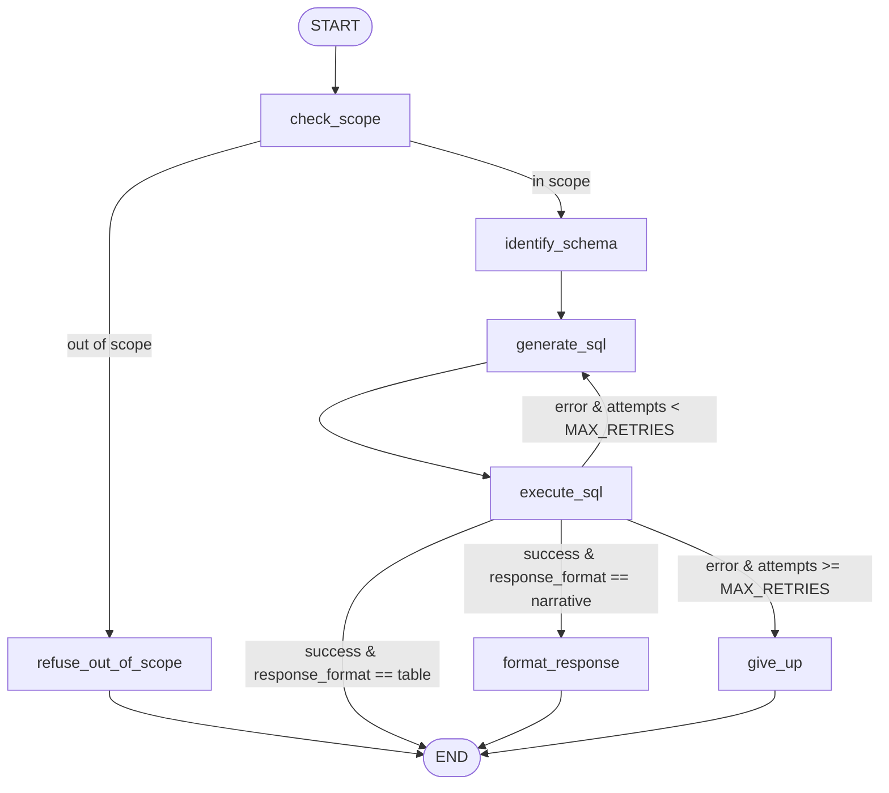

# NBA Text-to-SQL Agent

A LangGraph agent that answers natural-language questions about NBA data by generating SQL, executing it against a local SQLite database, and self-correcting when a query fails — rather than just generating SQL once and giving up on error.

## What it does

Ask a plain-English question about the data (e.g. *"Which team had the best record last season?"* or *"What are the top 5 scorers by points per game?"*), and the agent:

1. Checks whether the question can be answered from this database at all. If not, it refuses and explains why.
2. Figures out which tables/columns are relevant to the question.
3. Generates a SQL query against those tables.
4. Executes it.
5. If the query fails, feeds the real error back into generation and tries again — up to a capped number of attempts — rather than surfacing a raw database error to the user.
6. Returns either a formatted table or a natural-language answer, depending on what kind of question was asked.

## Architecture



**Nodes:**

- **`check_scope`** — runs first. Given the question and the database's table names, decides whether the question can be answered from this data at all, and gives a short reason. It defaults to in-scope when unsure (see *Design decisions*).
- **`refuse_out_of_scope`** — handles questions `check_scope` rejects. Pure Python, no LLM call. Builds a response from the reason and sets `refused` to True.
- **`identify_schema`** — given the question, identifies which tables and columns are relevant, and classifies whether the answer should be returned as a `table` or a `narrative` (see *Design decisions* below for why this lives here rather than later in the pipeline).
- **`generate_sql`** — generates a SQL query for the question. On a retry, the previous attempt's real database error is fed back into the prompt so the model can correct itself.
- **`execute_sql`** — runs the query against the SQLite database. Pure Python, no LLM call — it's a deterministic operation (run the query, catch `sqlite3.Error`), so there's nothing for a model to "interpret."
- **`format_response`** — turns a successful, non-empty query result into a natural-language answer (narrative path only; a table-format answer skips this node entirely and returns the result directly).
- **`give_up`** — the terminal error path once retries are exhausted. Returns a clean, abstracted message to the user while logging the real error server-side for debugging, and sets `refused` to True.

**Scope routing (`route_after_check_scope`):** in-scope questions go to `identify_schema`; out-of-scope questions go to `refuse_out_of_scope` and end.

**Routing (`route_after_execute`)** is three-way, not a simple success/failure branch:
- Success + `table` format → done, return the result directly.
- Success + `narrative` format → `format_response`.
- Error + attempts remaining → back to `generate_sql` (self-correction).
- Error + retries exhausted → `give_up`.

## Design decisions

A few choices worth calling out, since they weren't the first/obvious approach:

**`execute_sql`, `give_up`, and `refuse_out_of_scope` make no LLM calls.** Running a query and logging a failure are both deterministic operations — spending an API call to "interpret" either one is pure overhead. Structured output (vs. a plain model call) is used only where a node needs to reliably extract one specific value from a response that could be phrased many ways (`generate_sql`'s SQL string, `identify_schema`'s table list + format classification, `check_scope`'s in-scope decision); a plain call is used where the whole response *is* the answer (`format_response`).

**Query results are passed around as a list of dicts, not tuples.** Column names travel with each row via `cursor.description`, so downstream nodes and prompts don't need the schema passed around separately.

**The scope check is its own node, and it defaults to in-scope.** It runs before schema identification and sees only the table names, not the full schema, so it's cheap. When unsure, it answers in-scope: refusing an answerable question costs more than attempting an unanswerable one. The eval reflects that trade-off — no answerable question was refused, but some out-of-scope questions get through (see *Results*).

**Refusal is an explicit flag, not an inferred error.** Nodes that refuse or give up set `refused: True` in the state. Evaluators read that flag, so refusal doesn't depend on whether a SQL error happened to occur.

**`response_format` (table vs. narrative) is decided once, in `identify_schema` — not in `generate_sql`.** `identify_schema` runs once per question, upstream of the self-correction loop, so the output format is classified exactly once and can't flip-flop across retries. The trade-off: this mixes two concerns (schema identification and output-format intent) into one structured-output call. A cleaner long-term home would be a dedicated "interpret the question" node upstream of both — deferred for now since it isn't needed for the current scope.

**`MAX_RETRIES` caps total attempts, not additional retries.** `attempts` increments on every call to `generate_sql`, including the first, so `MAX_RETRIES = 3` means 3 total attempts (1 initial + 2 corrections) before giving up — not 3 retries on top of a first try.

**Failure messages are abstracted from the raw error.** When retries are exhausted, the user-facing message never surfaces the raw SQLite error text, even though that same raw text is exactly what gets fed back into the model during self-correction. Useful context for the model; not a user-facing string.

**The model never re-emits a table it already has.** `format_response`'s prompt takes the query result as *input* context so it can synthesize a sentence, but it's never asked to reproduce the table itself — that would waste tokens and risk the model mangling a value in transcription. When both a table and narrative are wanted, they're paired outside the graph, not inside a single model call.

## Observability & Evaluation

Tracing is wired up via [LangSmith](https://www.langchain.com/langsmith) — every run, including self-correction retries, traces automatically with no code changes (env-var configuration only). A traced run shows the full graph execution as a nested waterfall, with every node and LLM call (prompt in, structured output out) individually inspectable, including each `generate_sql` → `execute_sql` pair in a retry sequence.

**Eval dataset:** 21 hand-written questions against the real database, split into three categories that exercise the three response paths — 8 "table" questions (expects a result set), 8 "narrative" questions (expects a prose answer, scored by an LLM-as-judge against a ground-truth statement), and 5 "out_of_scope" questions (wrong sport, nonsensical, future data, or data the schema simply doesn't have).

**Evaluators:**
- `table_check` — compares the returned result set against ground truth (shape, columns, values). Applies to the 8 table questions.
- `narrative_correct_check` — LLM-as-judge, checks the prose answer against a ground-truth statement (not string-matched, since phrasing varies). Applies to the 8 narrative questions.
- `refuse_check` — code-based. Checks whether the agent set `refused` on the 5 out-of-scope questions.
- `false_refusal_check` — code-based. Checks that the agent did *not* set `refused` on the 16 in-scope questions. Without it, an agent that refused everything would score 5/5 on `refuse_check`.

**Results:**

| Run | table_check | narrative_correct_check | refuse_check | false_refusal_check |
|---|---|---|---|---|
| Gemini 3.1 Flash-Lite | 3/8 | 6/8 | 2/5 | — |
| Claude Haiku 5.5 | 0/8 | 6/8 | 0/5 | — |
| Claude Haiku 5.5 + scope check | 0/8 | 7/8 | 3/5 | 16/16 |

The first two runs measured refusal by whether a SQL error was raised. The scope-check run measures it with the `refused` flag, so the `refuse_check` column isn't directly comparable across those rows.

**What the scope check changed:**

- It refused 3 of the 5 out-of-scope questions: the meaning-of-life question, the 2030 Lakers record, and the Celtics touchdowns question. Each refusal gave a reason that matched what the question actually needs.
- It refused none of the 16 answerable questions.
- The two misses are informative:
  - **Game 7 scorer.** The scope check judged this answerable, citing `play_by_play`, which records player names and event types. The generated SQL returned no rows, and the narrative answered from general knowledge, which the response said explicitly. The question stays labeled out-of-scope, since the database has no per-game player stats table and reconstructing points from play-by-play text is unreliable. That label was set before the run.
  - **Batting average.** The scope check read "batting average" as a possible shooting stat and applied its default to in-scope. The agent correctly reported that no usable data existed, but the question wasn't refused.
- **Table results didn't change.** The 0/8 comes from the two issues already documented: `table_check`'s strict column matching, and the All-Star-games problem in SQL generation.
- **The Chicago Bulls narrative now passes** in both scope-check runs after failing in the baseline. I haven't isolated the cause. The scope check doesn't feed the SQL step, so this is most likely run-to-run variation. The earlier diagnosis was a short-name mismatch in the SQL (`'Chicago Bulls'` vs. `'Bulls'`), so that bug may still be present and just not triggered this time.

**Caveats:**

- Each configuration was run once. LLM output varies between runs, so one-question differences fall within the variation we've seen.
- The first scope-check run had a metadata error on the touchdowns example, which left its `refuse_check` score blank. The example was corrected and the eval was rerun. Only the rerun is reported here.

**Net read:** core text-to-SQL behavior is similar across providers. Most of the earlier apparent regression came from two evaluator assumptions — exact column sets, and refusal as a SQL error. The scope check addresses the refusal side: it catches more out-of-scope questions without refusing any answerable ones. The remaining misses point to two specific decisions: how to handle partly answerable questions, and what to do when a query returns no rows.

## Project structure

```
nba_text_to_sql_project/
├── agent/
│   ├── graph.py              # graph construction and compilation
│   ├── nodes.py              # node implementations
│   ├── prompts.py            # prompt templates
│   ├── state.py              # shared state definition
│   ├── helpers.py            # shared utilities
│   ├── eval_datasets.py      # LangSmith eval dataset upload (one-time)
│   ├── eval.py                # evaluators + experiment runner
│   └── eval_dataset_results/  # ground-truth CSVs backing the eval dataset
├── data/
│   └── nba.sqlite             # local SQLite database — not committed, see Setup
├── backfill.py                 # one-time data-loading utility — AI-generated, see Setup
├── pyproject.toml
├── uv.lock
└── README.md
```

## Setup

Requires Python 3.14. Dependencies are managed with [uv](https://docs.astral.sh/uv/) (`pyproject.toml` + `uv.lock`).

```bash
git clone https://github.com/<your-username>/nba_text_to_sql_project.git
cd nba_text_to_sql_project
uv sync
```

Create a `.env` file in the project root (not committed) with:

```
ANTHROPIC_API_KEY=your-key-here
# GOOGLE_API_KEY=your-key-here   # optional — only needed if you switch the provider in nodes.py

# Optional — enables LangSmith tracing
LANGCHAIN_TRACING_V2=true
LANGCHAIN_API_KEY=your-langsmith-key-here
LANGCHAIN_PROJECT=sql-agent
```

**Database:** `data/nba.sqlite` (~5GB) isn't committed to this repo — see `.gitignore`. To rebuild it:

1. Download the base dataset from Kaggle: [NBA Database](https://www.kaggle.com/datasets/wyattowalsh/basketball/data) (wyattowalsh/basketball), and load it into `data/nba.sqlite`.
2. Run `backfill.py` to populate `team_info_common`, which is empty in the raw Kaggle dataset — it pulls historical team-season stats from the live NBA Stats API instead. This step is required; without it, any question involving team season records/standings will return no data.

**Note:** `backfill.py` was written by Claude (AI-generated), not hand-implemented — unlike the agent's own node code, which Sunny wrote himself (see *Design decisions*). It's a one-time data-loading utility, delivered as a ready-to-run script rather than something built as part of the agent's architecture.

## Usage

Run from the project root. The agent modules import each other directly, so `agent/` needs to be on the Python path, and the database path is relative to the project root:

```python
import sys
sys.path.insert(0, "agent")

from graph import graph

initial_state = {
    "question": "Which team had the best record last season?",
    "sql": None, "tables": [], "variables": [], "result": None, "error": None,
    "attempts": 0, "response_format": None, "response": None,
    "in_scope": None, "scope_reason": None, "refused": False,
}
final_state = graph.invoke(initial_state)
print(final_state["response"])
```

## Known limitations

**Agent:**
- SQL generation doesn't reliably filter out All-Star/exhibition games for "highest"/"most" style aggregate questions — confirmed independently on two questions (fast-break points, highest-scoring game), across both LLM providers tested.
- The scope check defaults to in-scope when unsure. That keeps false refusals at zero in the eval, but some out-of-scope questions get through: one that the database can only partly support (Game 7 scorer), and one that asks for a stat the schema doesn't have (batting average).
- When a query returns no rows, the narrative layer can answer from general knowledge instead of reporting that no data was found.
- "Top N" style questions are always classified as table-format. Consistent, intentional behavior given the current classification approach, not a bug — flagged here in case it's worth revisiting later.

**Eval harness (not the agent):**
- `table_check` requires an exact column-set match, which penalizes a technically-correct answer that happens to include extra (not wrong) columns.
- Evaluators return `None` for examples they don't apply to, and LangSmith logs those as errors on the affected rows. Scores for applicable rows are unaffected, but the error logs are noisy.
- Each configuration has been run once, so run-to-run variation isn't yet measured.

## Roadmap

- Decide how the scope check should handle partly answerable questions, and whether to keep the in-scope default. Test that decision on a fresh, held-out set of out-of-scope questions rather than the current eval set.
- Don't answer from general knowledge when a query returns no rows.
- Fix the All-Star-game filtering gap in SQL generation.
- Loosen `table_check` to compare on requested columns/values rather than exact column-set equality.
- Run repeated evaluations to measure variance before comparing configurations.
- Safety guardrails (read-only DB access, blocking destructive queries)
- A basic UI (CLI at minimum)
