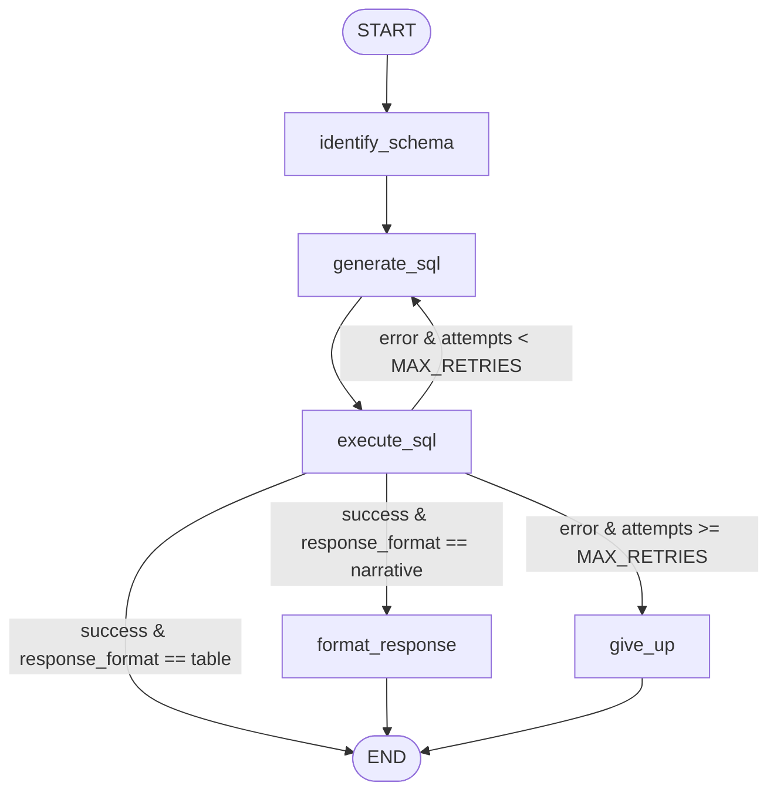

# NBA Text-to-SQL Agent

A LangGraph agent that answers natural-language questions about NBA data by generating SQL, executing it against a local SQLite database, and self-correcting when a query fails — rather than just generating SQL once and giving up on error.

## What it does

Ask a plain-English question about the data (e.g. *"Which team had the best record last season?"* or *"What are the top 5 scorers by points per game?"*), and the agent:

1. Figures out which tables/columns are relevant to the question.
2. Generates a SQL query against those tables.
3. Executes it.
4. If the query fails, feeds the real error back into generation and tries again — up to a capped number of attempts — rather than surfacing a raw database error to the user.
5. Returns either a formatted table or a natural-language answer, depending on what kind of question was asked.

## Architecture



**Nodes:**

- **`identify_schema`** — given the question, identifies which tables and columns are relevant, and classifies whether the answer should be returned as a `table` or a `narrative` (see *Design decisions* below for why this lives here rather than later in the pipeline).
- **`generate_sql`** — generates a SQL query for the question. On a retry, the previous attempt's real database error is fed back into the prompt so the model can correct itself.
- **`execute_sql`** — runs the query against the SQLite database. Pure Python, no LLM call — it's a deterministic operation (run the query, catch `sqlite3.Error`), so there's nothing for a model to "interpret."
- **`format_response`** — turns a successful, non-empty query result into a natural-language answer (narrative path only; a table-format answer skips this node entirely and returns the result directly).
- **`give_up`** — the terminal error path once retries are exhausted. Returns a clean, abstracted message to the user while logging the real error server-side for debugging.

**Routing (`route_after_execute`)** is three-way, not a simple success/failure branch:
- Success + `table` format → done, return the result directly.
- Success + `narrative` format → `format_response`.
- Error + attempts remaining → back to `generate_sql` (self-correction).
- Error + retries exhausted → `give_up`.

## Design decisions

A few choices worth calling out, since they weren't the first/obvious approach:

**`execute_sql` and `give_up` make no LLM calls.** Running a query and logging a failure are both deterministic operations — spending an API call to "interpret" either one is pure overhead. Structured output (vs. a plain model call) is used only where a node needs to reliably extract one specific value from a response that could be phrased many ways (`generate_sql`'s SQL string, `identify_schema`'s table list + format classification); a plain call is used where the whole response *is* the answer (`format_response`).

**Query results are passed around as a list of dicts, not tuples.** Column names travel with each row via `cursor.description`, so downstream nodes and prompts don't need the schema passed around separately.

**`response_format` (table vs. narrative) is decided once, in `identify_schema` — not in `generate_sql`.** `identify_schema` runs once per question, upstream of the self-correction loop, so the output format is classified exactly once and can't flip-flop across retries. The trade-off: this mixes two concerns (schema identification and output-format intent) into one structured-output call. A cleaner long-term home would be a dedicated "interpret the question" node upstream of both — deferred for now since it isn't needed for the current scope.

**`MAX_RETRIES` caps total attempts, not additional retries.** `attempts` increments on every call to `generate_sql`, including the first, so `MAX_RETRIES = 3` means 3 total attempts (1 initial + 2 corrections) before giving up — not 3 retries on top of a first try.

**Failure messages are abstracted from the raw error.** When retries are exhausted, the user-facing message never surfaces the raw SQLite error text, even though that same raw text is exactly what gets fed back into the model during self-correction. Useful context for the model; not a user-facing string.

**The model never re-emits a table it already has.** `format_response`'s prompt takes the query result as *input* context so it can synthesize a sentence, but it's never asked to reproduce the table itself — that would waste tokens and risk the model mangling a value in transcription. When both a table and narrative are wanted, they're paired outside the graph, not inside a single model call.

## Observability & Evaluation

Tracing is wired up via [LangSmith](https://www.langchain.com/langsmith) — every run, including self-correction retries, traces automatically with no code changes (env-var configuration only). A traced run shows the full graph execution as a nested waterfall, with every node and LLM call (prompt in, structured output out) individually inspectable, including each `generate_sql` → `execute_sql` pair in a retry sequence.

**Eval dataset:** 21 hand-written questions against the real database, split into three categories that exercise the three response paths — 8 "table" questions (expects a result set), 8 "narrative" questions (expects a prose answer, scored by an LLM-as-judge against a ground-truth statement), and 5 "out_of_scope" questions (wrong sport, nonsensical, future data, or data the schema simply doesn't have).

**Evaluators:**
- `table_check` — compares the returned result set against ground truth (shape, columns, values).
- `narrative_correct_check` — LLM-as-judge, checks the prose answer against a ground-truth statement (not string-matched, since phrasing varies).
- `refuse_check` — code-based; checks whether the final state carries an unresolved error, as a proxy for "the agent gave up rather than hallucinating."

**Baseline run (Gemini 3.1 Flash-Lite):** `table_check` 3/8, `narrative_correct_check` 6/8, `refuse_check` 2/5.

**Comparison run (Claude Haiku 5.5), same dataset, same evaluators, one deliberate change (LLM provider):** `table_check` 0/8, `narrative_correct_check` 6/8 (identical failures), `refuse_check` 0/5.

The `table_check` and `refuse_check` numbers look like a regression at a glance. Tracing every failing row back to its actual output tells a different story:

- **7 of 8 `table_check` "failures" aren't wrong answers.** Claude's generated SQL consistently adds identity columns (`team_id`, `team_city`, `team_abbreviation`) alongside whatever was asked for; the actual requested values match ground truth exactly in all 7 cases. `table_check`'s exact-column-set comparison turned out to be stricter than the question warranted — a finding about the evaluator, not the agent. (The 8th failure, "5 highest-scoring games," is a genuine bug independent of provider: the generated SQL still doesn't filter out All-Star games — the same root cause as the fast-break-points failure under Gemini.)
- **`refuse_check`'s 0/5 is an evaluator blind spot, not worse behavior.** The check assumes refusal shows up as `state['error'] is not None` — true for Gemini, which either fabricates a trivially "successful" query or exhausts retries into a real SQL error. Claude almost never hits a SQL error at all: it writes valid-but-pointless SQL and catches the mismatch in the *narrative* layer instead. For "how many touchdowns did the Celtics score," for example, it computed a real point total but the response correctly notes touchdowns are a football term that doesn't apply. In at least 3 of 5 cases, Claude's actual response is a more appropriate refusal than Gemini's — the evaluator just can't see it, because refusal doesn't always route through a SQL error.

Net read: core text-to-SQL behavior is consistent across providers (the same two genuine narrative bugs show up regardless of model), and the headline score swing is mostly an artifact of two assumptions baked into the evaluators — exact column match, and error-as-refusal-signal — that held for one model's failure style but not the other's.

## Project structure

```
nba_text_to_sql_project/
├── agent/
│   ├── graph.py                 # graph construction and compilation
│   ├── nodes.py                 # node implementations
│   ├── prompts.py                # prompt templates
│   ├── state.py                   # shared state definition
│   ├── helpers.py                  # shared utilities
│   ├── eval_datasets.py             # LangSmith eval dataset upload (one-time)
│   ├── eval.py                       # evaluators + experiment runner
│   └── eval_dataset_results/          # ground-truth CSVs backing the eval dataset
├── data/
│   └── nba.sqlite                      # local SQLite database — not committed, see Setup
├── backfill.py                          # one-time data-loading utility — AI-generated, see Setup
├── pyproject.toml
├── uv.lock
└── README.md
```

## Setup

Requires Python 3.14. Dependencies are managed with [uv](https://docs.astral.sh/uv/) (`pyproject.toml` + `uv.lock`).

```bash
git clone https://github.com/<your-username>/nba_text_to_sql_project.git
cd nba_text_to_sql_project
uv sync
```

Create a `.env` file in the project root (not committed) with:

```
ANTHROPIC_API_KEY=your-key-here
# GOOGLE_API_KEY=your-key-here   # optional — only needed if you switch the provider in nodes.py

# Optional — enables LangSmith tracing
LANGCHAIN_TRACING_V2=true
LANGCHAIN_API_KEY=your-langsmith-key-here
LANGCHAIN_PROJECT=sql-agent
```

**Database:** `data/nba.sqlite` (~5GB) isn't committed to this repo — see `.gitignore`. To rebuild it:

1. Download the base dataset from Kaggle: [NBA Database](https://www.kaggle.com/datasets/wyattowalsh/basketball/data) (wyattowalsh/basketball), and load it into `data/nba.sqlite`.
2. Run `backfill.py` to populate `team_info_common`, which is empty in the raw Kaggle dataset — it pulls historical team-season stats from the live NBA Stats API instead. This step is required; without it, any question involving team season records/standings will return no data.

**Note:** `backfill.py` was written by Claude (AI-generated), not hand-implemented — unlike the agent's own node code, which Sunny wrote himself (see *Design decisions*). It's a one-time data-loading utility, delivered as a ready-to-run script rather than something built as part of the agent's architecture.

## Usage

Currently invoked via script — see `text_to_sql_project/agent/graph.py` for the compiled graph. A minimal example:

```python
from text_to_sql_project.agent.graph import graph

initial_state = {"question": "Which team had the best record last season?"}
final_state = graph.invoke(initial_state)
print(final_state["response"])
```

## Known limitations

**Agent:**
- SQL generation doesn't reliably filter out All-Star/exhibition games for "highest"/"most" style aggregate questions — confirmed independently on two different questions (fast-break points, highest-scoring game), across both LLM providers tested.
- Out-of-scope or malformed questions don't reliably route through the self-correction/give-up path. Whether a question gets refused via a SQL error or via the narrative layer currently depends on the LLM provider, not on an explicit scope-detection step — see *Observability & Evaluation* above.
- "Top N" style questions are always classified as table-format. Consistent, intentional behavior given the current classification approach, not a bug — flagged here in case it's worth revisiting later.

**Eval harness (not the agent):**
- `table_check` requires an exact column-set match, which penalizes a technically-correct answer that happens to include extra (not wrong) columns.
- `refuse_check` assumes refusal always shows up as a SQL execution error — true for one tested provider, not the other.

## Roadmap

- Explicit scope-detection step upstream of SQL generation, so refusal doesn't depend on incidental SQL-error behavior
- Fix the All-Star-game filtering gap in SQL generation
- Loosen `table_check` to compare on requested columns/values rather than exact column-set equality
- Give `refuse_check` a model-agnostic signal (e.g. an explicit `refused: bool` set by `format_response`/`give_up`) instead of inferring refusal from `error is not None`
- Safety guardrails (read-only DB access, blocking destructive queries)
- A basic UI (CLI at minimum)
